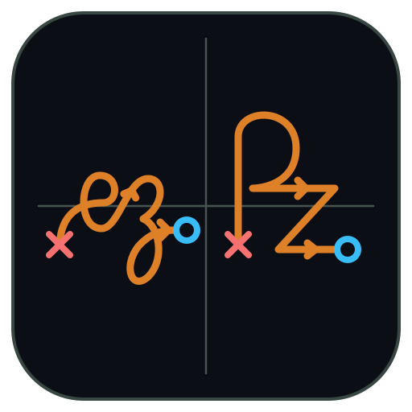

<p align="center">
  
</p>

<h1 align="center">ezPZ</h1>
<p align="center">
  <b>Interactive Control Theory and Digital Signal Processing Tool</b>
</p>

---
**ezPZ** (formerly known as **Control Systems Suite**) is an all-in-one tool for electrical engineering students, specifically those in **Classical or Modern Control Theory** and **Digital Signals Processing**. ezPZ is cross-platform, built on `C++` with `Eigen3` and `Qt6`. The goal is to unify continuous-time $s$-plane root locus design, discrete-time $z$-plane digital filter visualization, time-domain response simulation, frequency analysis, block diagram algebra, Routh-Hurwitz stability tables, and signal plotting into a single desktop application.

---

## Features

* **1. $s$-plane Root Locus & Compensator Designer (`rootlocustab`)**

* **2. Continuous Time-Response & PID Synthesizer (`PIDTimeResponseTab`)**

* **3. $z$-plane Digital Filter Designer (`ZPlaneFilterTab`)**

* **4. Discrete-Time Response (`DiscreteTimeResponseTab`)**

* **5. Frequency-Domain Suite (`FrequencyResponseTab` & `BodyNyquistCanvas`)**

* **6. Routh-Hurwitz Table Constructor and Symbolic Solver (`RouthHurwitzTab`)**

* **7. Block Diagram Studio (`BlockDiagramStudioTab` & `BlockDiagramCanvas`)**

* **8. Signal Plotter, Scientific Calculator & Formula Reference**

* **9. Built-in Themes, Vector `.svg` Export & CLI Mode**

---

## Pre-Built Downloads and Running Instructions

Pre-compiled standalone bundles for **Windows**, **macOS (Universal Intel & Apple Silicon)**, and **Linux** are automatically built via GitHub Actions. Download them from the **Releases** page or the latest workflow run under the **Actions** tab.

### Windows (`ezPZ-Windows-x64.zip`)
1. Extract the entire `.zip` archive. Keep `ezpz.exe` alongside its bundled `.dll` files and plugin folders.
2. Launch `ezpz.exe`.
3. On first launch, Windows SmartScreen may prompt you. If so, click **More Info** $\rightarrow$ **Run Anyway**.

### macOS (`ezPZ-macOS-Universal.dmg` / `.zip`)
1. Open `ezPZ-macOS-Universal.dmg` and drag `ezPZ.app` to **Applications**.
2. Before first launch, you may need to bypass the Gatekeeper. To do so, run the following in your terminal:
    ```bash
    xattr -cr /Applications/ezPZ.app
    ```
### Linux (`ezPZ-Linux-x86_64`)
1. Unzip the artifact to access the standalone AppImage, portable tarball, and desktop menu installer:
#### Option A - 1-click Start Menu install (Recommended)
```bash
./install.sh
```
#### Option B - Direct AppImage execution
```bash
chmod +x ezPZ-Linux-x86_64.AppImage
./ezPZ-Linux-x86_64.AppImage
```
## 💡 Tips & Hidden Features

While most controls in **ezPZ** are interactive via sliders and tables, several advanced capabilities are tucked into context menus, syntax parsers, and secondary dialogs. Click any topic below to expand:

<details>
<summary><b>1. Symbolic Algebra (Using Unknown Variables like <code>K</code> or <code>x</code>)</b></summary>
<br>

**ezPZ** includes a built-in rational symbolic algebra engine (`SymRat`):
* **Routh-Hurwitz & Block Diagram Studio:** You can type `K` directly inside transfer function numerators, denominators, or block expressions (e.g., `K / (s*(s+2))` or `s^3 + 6s^2 + 8s + K`). The solver will automatically construct the symbolic Routh array or Mason's gain reduction in terms of $K$ and solve for the exact stability range.
* **Scientific Calculator:** Declare a free symbolic variable on a line using `sym x` (or `sym K`), then use it in subsequent rows—including inside complex impedance calls like `parallel(10, 1/(s*C))`—to get simplified rational polynomial fractions.
</details>

<details>
<summary><b>2. Canvas Interactions, Pole-Sweep Mode & Target Bullseyes</b></summary>
<br>

* **Pan & Zoom:** Scroll wheel zooms toward the cursor; click-and-drag pans the complex plane.
* **Snap to Critical Landmarks:** Enable the checkboxes for **Breakaway/In**, **$j\omega$ Crossings**, or **Spec Boundaries ($\zeta, T_s, T_p$)**. Clicking near any green $\odot$ intersection bullseye or critical marker snaps the active test point directly onto that coordinate and displays the required loop gain $K$ and compensator angle deficiency $\Delta\theta$.
* **Root Contour (Pole Sweep) Mode:** In the $s$-Plane Root Locus tab, switch the mode dropdown from **Sweep Gain $K$** to **Sweep Open-Loop Pole $s = -a$** to lock $K = K_0$ and trace how the closed-loop poles move as a single plant pole varies from $0 \to \infty$.
</details>

<details>
<summary><b>3. Keep vs. Change Design Matrix & Step-by-Step Homework Derivations</b></summary>
<br>

* Click **Design Parameters...** in the Continuous Time-Response tab to open the **Keep vs. Change Synthesizer**.
* Lock any two compatible second-order specifications (e.g., lock `%OS` and `Ts` to **KEEP**, and set `ζ`, `ω_n`, `Kp`, `Kd` to **CHANGE**).
* Click **▶ Show Calc** on any solved row (or toggle **Show All Calculations**) to expand the full symbolic formula, numerical substitution, and step-by-step derivation used to compute that parameter.
</details>

<details>
<summary><b>4. Independent vs. Synced Tabs & Custom Feedback <code>H(s)</code></b></summary>
<br>

* **Cross-Tab Sync Toggle (`Sync ON` / `Sync OFF`):** Located in the top navigation bar (and `⚙ Settings`). By default, editing $G(s)$ in the Root Locus tab updates the Time Response and Bode tabs automatically. Toggle Sync **OFF** if you want to compare two different transfer functions across tabs without overwriting them.
* **Non-Unity Feedback $H(s)$ / $H_{\text{fb}}(z)$:** Switch the feedback bar from **Unity $H=1$** to **Custom $H(s)$** to reveal a dedicated pole-zero and polynomial editor for your sensor/feedback transfer function. Click the formula toggle button (`Formula: G(s), H(s)` $\leftrightarrow$ `Formula: Closed-Loop T(s)`) to switch the live LaTeX banner between open-loop components and the reduced closed-loop transfer function $T(s) = \frac{C(s)G(s)}{1 + C(s)G(s)H(s)}$.
* **Classroom Rounding Rules (`⚙ Settings`):** Need your numbers to match hand-calculated homework rules (e.g., 3 decimal places for $0 < |x| < 1$ and 2 decimal places for $|x| \ge 1$, plus intermediate step-rounding)? Open **⚙ Settings** in the top bar to switch rounding modes globally.
</details>

